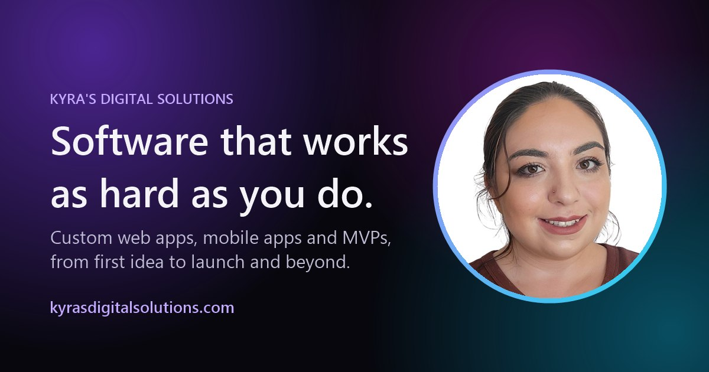

# Kyra's Digital Solutions

The portfolio and business site for Kyra's Digital Solutions, designed and built by Kyra Thomas.

**Live site:** [kyrasdigitalsolutions.com](https://kyrasdigitalsolutions.com)



## What's here

A fast, dependency-free static site: hand-written HTML, CSS and JavaScript, deployed on Netlify.

| Page | What it does |
|---|---|
| **Home** (`index.html`) | Hero, services, process, recent projects, testimonials and FAQ |
| **Portfolio** (`portfolio.html`) | Blog-style case studies with topic filters, search, pinned posts and a reading view |
| **Testimonials** (`testimonials.html`) | Client and collaborator testimonials |
| **Resume** (`resume.html`) | Web resume with a separate single-column print layout for PDF export |
| **Contact** (`contact.html`) | Project inquiry form handled by Netlify Forms |

## Design system

All color lives in semantic tokens defined in [`css/styles.css`](css/styles.css).

- **Tokens only.** Components reference semantic color tokens like `--surface`, `--accent`, `--focus-ring` or `--cover-label-bg`. There are no raw palette values or bare `rgba()` literals outside the token definitions.
- **Both themes, always.** Every dark-mode token has a light-mode counterpart, so the theme toggle and `prefers-color-scheme` switch the whole site cleanly.
- **Extend, don't patch.** When a surface needs something new, it gets a new token for both themes rather than a one-off override.
- **Verified visually.** Moving the remaining hard-coded colors into tokens was checked with before-and-after screenshots of every page in both themes, compared pixel by pixel.

Typography uses Space Grotesk for display, Inter for body text and JetBrains Mono for labels.

## Notable details

- **Data-driven portfolio.** Every case study is an object in [`js/posts.js`](js/posts.js). Posts render as cards on the home page and portfolio, with hash-based routing (`portfolio.html#tier-tech`) for the reading view. `pinned: 1, 2, ...` keeps posts at the top.
- **Print-ready resume.** A dedicated `@media print` layout turns the two-column web resume into a clean single-column PDF.
- **Contact form.** Netlify Forms over `fetch`, with client-side validation, a honeypot spam field and a local fallback that opens the visitor's email app.
- **Accessibility.** Semantic landmarks, visible focus states, labelled controls, `aria-current` navigation and `prefers-reduced-motion` support.
- **Search and sharing.** Canonical URLs, Open Graph and Twitter card tags, a branded 1200×630 share image, `sitemap.xml` and `robots.txt`.
- **Hosting config.** [`netlify.toml`](netlify.toml) adds security headers and image caching, and `404.html` is a branded not-found page.

## Project structure

```
├── index.html, portfolio.html, testimonials.html, resume.html, contact.html, 404.html
├── css/styles.css     # design tokens, components, responsive and print styles
├── js/main.js         # theme toggle, menu, scroll reveals, contact form
├── js/posts.js        # portfolio case studies (content + ordering)
├── assets/            # images, screenshots, favicon, share image
├── netlify.toml       # headers and caching
└── sitemap.xml, robots.txt
```

## Run it locally

There's no build step. Serve the folder with any static file server, for example:

```bash
npx serve .
```

Then open the address it prints. (Opening the HTML files directly also works, but the contact form falls back to email locally.)

## Adding a portfolio post

Copy the commented template at the top of `js/posts.js`, give it a unique `slug`, and write the body as HTML. Posts appear in list order, after any pinned posts.

## How it was built

Built with the help of AI coding tools, with every change reviewed, tested in the browser and checked in both themes before shipping.

---

© Kyra's Digital Solutions. The code is shared so you can see how the site is built; the content, photos and client work shown on the site are not licensed for reuse.
